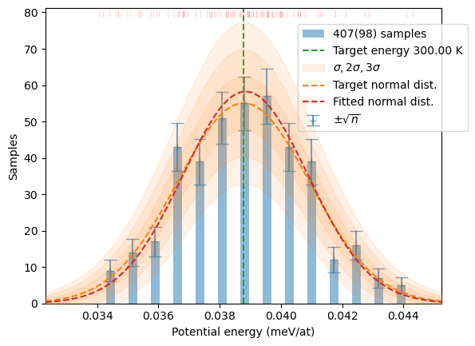

# HECSS

HECSS is a Monte-Carlo configuration space sampler using a sample weighting
algorithm for probability distribution sampling. It creates representations
of systems at thermal equilibrium without running an expensive molecular
dynamics simulation.

The physical background is described in
[SciPost Phys. 10, 129 (2021)](https://scipost.org/SciPostPhys.10.6.129) and
summarised on the [Background](background.md) page.

## Quick start

```python
from hecss import HECSS
from hecss.util import select_asap_model, create_asap_calculator
from hecss.monitor import plot_stats
from ase.build import bulk

model = select_asap_model('SiC')
cryst = bulk('SiC', crystalstructure='zincblende',
             a=4.38120844, cubic=True).repeat((3, 3, 3))
cryst.calc = create_asap_calculator(model)

sampler = HECSS(cryst, lambda: create_asap_calculator(model))
samples = sampler.sample(300, 100)
distribution = sampler.generate(samples, 300)
plot_stats(distribution, 300, sqrN=True)
```



## Installation

```bash
pip install hecss
```

See the [LAMMPS tutorial](tutorials/lammps.md) for a worked example and the
[CLI tutorial](tutorials/cli.md) for command line usage. The
[API reference](api/core.md) documents the public functions and classes.
