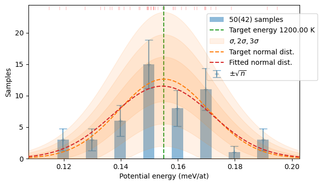
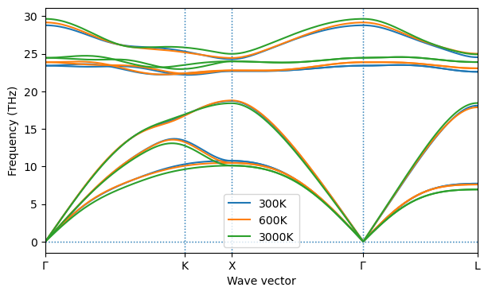

# CLI

> The command line interface for the HECSS sampler

## Command line hecss sampler

The HECSS sampler can be also used from the command line using `hecss-sampler` command:

```python
run_cli_cmd(hecss_sampler, '-V')
run_cli_cmd(hecss_sampler, '--help')
```

To use it you need to prepare:

1. `run-calc` script which should start the VASP calculation. You need to put this script in the root of your project tree. The example of such a script is included in the source as `run-calc.example`. :

```bash
#!/bin/bash

# This script should run vasp in current directory 
# and wait for the run to finish.
# 
# A generic line using SLURM would look like this:
#
# sbatch [job_params] -W vasp_running_script
#
# The "-W" param makes the sbatch command wait for the job to finish.


JN=`pwd`
JN=`basename ${JN}`

# Partition of the cluster
PART=small

# Number of nodes
N=1

# Number of MPI tasks
ntask=64

# Name the job after directory if no label is passed as first argument
if [ "${1}." != "." ]; then
  JN=${1}
fi

sbatch -W -J ${JN} -p $PART -N $N -n $ntask run-vasp-script
```

2. A directory with fully converged and optimized supercell structure which can be read in by the ASE `Vasp(restart=...)` command

3. A directory for the generated samples.

The directory tree may look like this:

```
my_project ----- sc
             |
             +-- T_100
             |
             +-- T_200
             |
             +-- ...
             |
             +-- run-calc
```

You execute the sampler from the `my_project` directory (remember to activate your virtual environment first). Generation of N=30 samples at T=100K:

```bash
~$ cd my_project
~$ hecss_sampler -W T_100 -T 100 -N 30 -c ./run-calc sc/CONTCAR
```

The above command will put the generated samples inside the `T_100` directory, together with the DFSET file with displacement-force data extracted from the calculation. The calculation may take a long time. Thus it is advisable to execute the hecss command inside `screen` (or some similar terminal multiplexer) to prevent the break of the calculation in case of session disconnection. The `hecss` command shows a progress to guide you through the calculation (ETA, time/it, data about last sample etc.). The example run is included at the bottom of this document.

## Width scale estimation

Calling the sampler with N=0 runs only width scale (eta) estimation procedure for the temperature range 0-T Kelvin. The calculated value may be used as the -w parameter in subsequent calculations. Possibly even for temperatures outside of this range.

```python
run_cli_cmd(hecss_sampler, 
            f"-W {calc_dir.name} "
            "-T 1000 -N 0 -e 10 "
            "-k 0 "
            "-c ./run-calc.sh "
            "example/VASP_3C-SiC/1x1x1/sc_1x1x1/CONTCAR")
```

## Calculating amplitude correction data

The amplitude correction data can be saved into the file (-s parameter) and used in subsequent calculations (see below). This will speed up the initial equilibration of the degrees of freedom. This will be merged with eta estimation in future versions.

```python
# reset output file
open(f'{calc_dir.name}/DFSET.dat', 'wt').close()
open(f'{calc_dir.name}/DFSET.dat.raw', 'wt').close()

run_cli_cmd(hecss_sampler, 
            f"-W {calc_dir.name} "
            "-T 300 -N 10 -w 1.85 "
            "-c ./run-calc.sh "
            "-s scale.dat "
            "example/VASP_3C-SiC/1x1x1/sc_1x1x1/CONTCAR")
```

## Calculate initial amplitude correction

By saving the amplitude correction coefficients into the file with `-s` option of the sampler we can initialise following calculations with proper relations of relative displacement amplitudes. This may be also used to continue 
the calculations with minimal startup overhead.

```python
run_cli_cmd(calculate_xscale, "--help")
run_cli_cmd(calculate_xscale, 
            f"-o {calc_dir.name}/iscale.dat -s 10 "
            "example/VASP_3C-SiC/1x1x1/sc_1x1x1/CONTCAR "
            f"{calc_dir.name}/T_300.0K/scale.dat")
```

## Continue the calculation

```python
# reset output file
open(f'{calc_dir_2.name}/DFSET.dat', 'wt').close()
open(f'{calc_dir_2.name}/DFSET.dat.raw', 'wt').close()

# Calculate 10 more samples
run_cli_cmd(hecss_sampler, 
            f"-W {calc_dir_2.name} -T 300 -N 10 -w 1.85 "
            f"-c ./run-calc.sh -s scale.dat -a {calc_dir.name}/iscale.dat"
            " example/VASP_3C-SiC/1x1x1/sc_1x1x1/CONTCAR")
```

##  Sampling re-shaping

The reshaper of the sample set to any given temperature.

```python
!cat TMP/${calc_dir.name}/T_300.0K/DFSET.dat.raw TMP/${calc_dir_2.name}/T_300.0K/DFSET.dat.raw > TMP/DFSET_raw.dat
!rm -f TMP/DFSET.dat
run_cli_cmd(reshape_sample, "--help")
run_cli_cmd(reshape_sample, 
            " -d -o TMP/DFSET.dat"
            " TMP/DFSET_raw.dat")
```

```python
!rm -f ${calc_dir.name}/T_300.0K/DFSET.dat
run_cli_cmd(reshape_sample, 
            f" -N 1 -w -d -o {calc_dir.name}/T_300.0K/DFSET.dat"
            f" --check {calc_dir.name}/T_300.0K/smpl"
            f" {calc_dir.name}/T_300.0K/DFSET.dat.raw")
```

## Command line statistics monitoring

This simple command line interface to the statistics plotting function allows for quick monitoring of the running calculation. If the sixelplot package is installed it is even possible to plot hi-res plots in the remote terminal supporting sixel standard (e.g. mlterm, xterm on Linux, iterm2 on OSX).

```python
run_cli_cmd(plot_stats, "--help")

run_cli_cmd(plot_stats, 
            "-n " 
            "-w 7 -h 4 "
            "TMP/DFSET_raw.dat "
            "300")
```

```python
run_cli_cmd(plot_stats, 
            "-n " 
            "-w 7 -h 4 "
            "TMP/DFSET.dat ")
```

```python
run_cli_cmd(plot_stats, 
               "-n " 
               "-w 7 -h 4 "
               "example/VASP_3C-SiC_calculated/2x2x2/T_1200K/DFSET.dat "
               "1200")
```



## Command line phonon monitoring

This simple command line interface to the phonon plotting function allows for quick monitoring of the phonon calculation. If the sixelplot package is installed it is even possible to plot hi-res plots in the remote terminal supporting sixel standard (e.g. mlterm, xterm on Linux, iterm2 on OSX).

```python
run_cli_cmd(plot_bands, "--help")
run_cli_cmd(plot_bands, 
               "-w 7 -h 4 -l '300K,600K,3000K' "
               "example/VASP_3C-SiC_calculated/2x2x2/T_300K/phon/cryst.bands "
               "example/VASP_3C-SiC_calculated/2x2x2/T_600K/phon/cryst.bands "
               "example/VASP_3C-SiC_calculated/2x2x2/T_3000K/phon/cryst.bands ")
```


